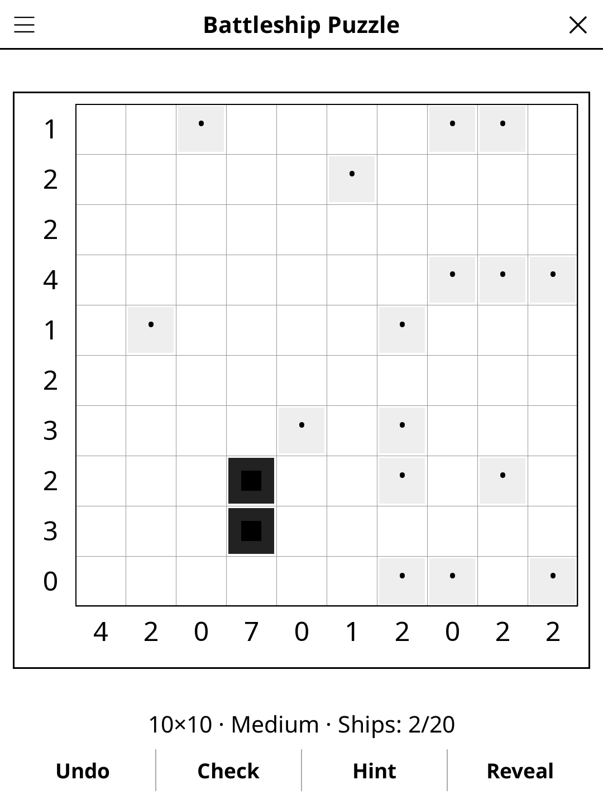

# battleship.koplugin

A Battleship Puzzle (Solitaire Battleships) plugin for [KOReader](https://github.com/koreader/koreader).

## Screenshot

## Rules

Find the hidden fleet in the grid. Row and column clues show the total number of ship segments in each line. Ships are placed horizontally or vertically and cannot touch each other (even diagonally).

## Concept

Solitaire Battleships (also called Bimaru) is a logic puzzle version of the
classic Battleship game. A fleet is hidden in a grid; row and column clues show
how many ship segments are in each line. Deduce the exact position of every ship
using logic alone — no guessing required.

The fleet typically consists of: 1 battleship (4), 2 cruisers (3), 3 destroyers (2),
4 submarines (1).

## Features

- **Multiple grid sizes** — 8×8 (classic), 10×10 (extended)
- **Three difficulty levels**, each checked by a built-in logic solver, so
  every puzzle has exactly one solution and never needs a guess:
  - **Easy** — many cells revealed; row/column counts and "water around a
    ship" are all you need
  - **Medium** — fewer reveals; you also count the ships already found
    (once all destroyers are placed, a two-cell run must grow, …)
  - **Hard** — fewest reveals; you also work out where the remaining ships
    can still fit
- **Cell states** — unknown, ship segment, water
- **Check** — highlights rows and columns whose ship count does not match the clue
- **Hint** — two taps: the first says which cell is about to give, the second acts on it. A cell that contradicts the solution is always reported before a fresh one is revealed
- **Reveal solution** — shows the full solution
- **Undo** — step back through your moves
- **Auto-save** — game state saved and restored on next launch

## Controls

| Action | How |
|--------|-----|
| Cycle a cell (ship → water → empty) | Tap it |
| Mark as water | Long-press |
| Undo last move | Tap **Undo** |
| Check progress | Tap **Check** |
| New game, size, difficulty, rules | Title bar menu |

## Why e-ink friendly?

Each tap places or removes a single cell marking. The grid is fully static
between moves — ideal for e-ink partial refresh.

## License

GPL-3.0
